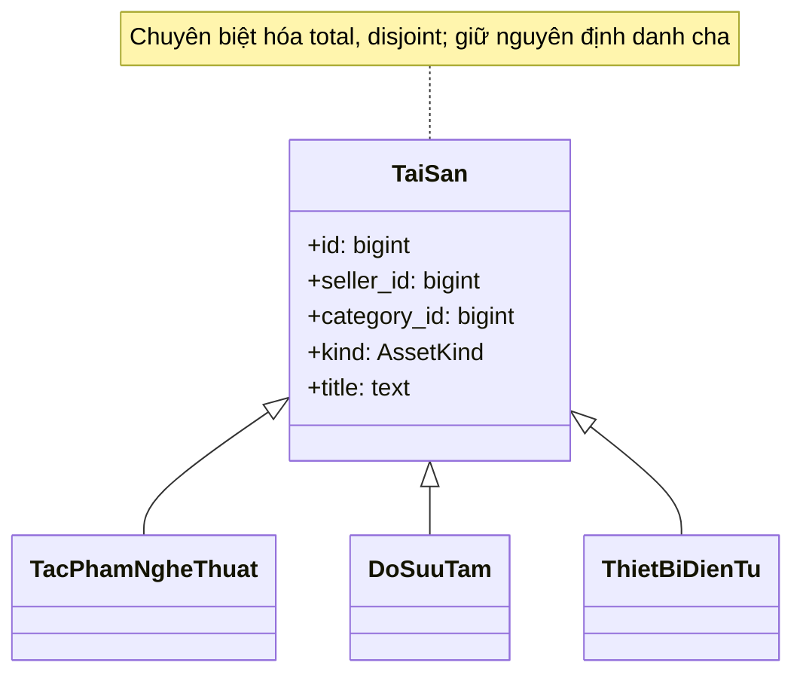
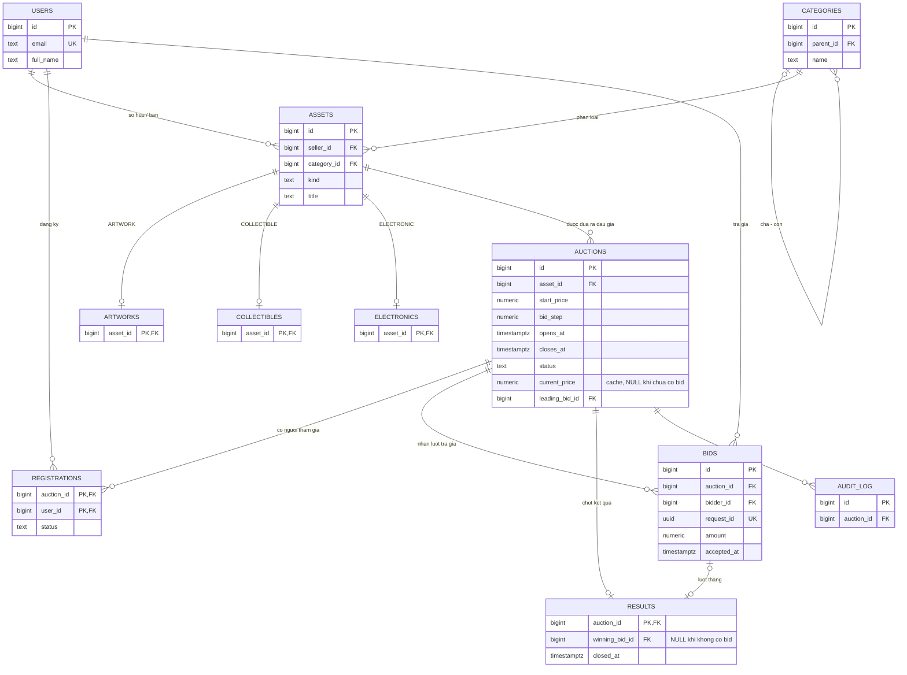

# Mô hình EER và ánh xạ quan hệ

## 1. Chuyên biệt hóa tài sản

`TaiSan` là lớp cha. Ba lớp con `TacPhamNgheThuat`, `DoSuuTam`, `ThietBiDienTu` có cùng định danh với tài sản cha.

- **Total**: mỗi tài sản thuộc một trong ba lớp con.
- **Disjoint**: một tài sản chỉ thuộc đúng một lớp con.
- `assets.kind` là thuộc tính phân loại: `ARTWORK`, `COLLECTIBLE`, `ELECTRONIC`.
- Ánh xạ bằng bảng cha `assets` và ba bảng con `artworks`, `collectibles`, `electronics`, trong đó `asset_id` đồng thời là PK và FK.
- Kiểm tra total/disjoint cần kiểm tra xuyên bảng ở cuối giao dịch. Chỉ có FK từ bảng con đến bảng cha chưa đủ để bảo đảm một tài sản có lớp con.

## 2. Quan hệ và lực lượng

Sơ đồ ER thể hiện mỗi bảng con là tùy chọn khi xét riêng; ràng buộc total/disjoint là ràng buộc bổ sung giữa **toàn bộ ba bảng con**. Đây là lý do cần mô tả chuyên biệt hóa riêng bên cạnh sơ đồ quan hệ.

## 3. Vai trò người dùng

Không tách `Seller` và `Bidder` thành hai loại người dùng loại trừ nhau. Vai trò người bán được suy ra qua `assets.seller_id`; vai trò người tham gia qua `registrations`. Một người có thể bán ở phiên A và trả giá ở phiên B. Quy tắc cấm người bán tự trả giá chỉ áp dụng cho tài sản của chính người đó.

`registrations` biểu diễn quan hệ nhiều-nhiều; khóa ghép `(auction_id, user_id)` ngăn đăng ký trùng. Một lượt trả giá hợp lệ cần người tham gia đã được duyệt tại phiên tương ứng.

## 4. Cây danh mục và kết quả

Danh mục có tối đa một cha; gốc có `parent_id IS NULL`. Cấm tự làm cha và cấm chu trình. Truy vấn đệ quy duyệt hậu duệ để tổng hợp số phiên, số lượt trả và doanh thu theo danh mục gốc.

Các sửa đổi cây là thao tác quản trị. Trigger đồng bộ bằng advisory lock và đọc trạng thái mới ở READ COMMITTED; SERIALIZABLE phải retry khi xung đột. Trigger từ chối sửa cây ở REPEATABLE READ vì snapshot có thể cũ dù đã chờ advisory lock. Quy tắc này ngăn hai quản trị viên đồng thời tạo chu trình bằng hai cạnh khác nhau.

`results.auction_id` là PK, bảo đảm tối đa một kết quả cho một phiên. Kết quả không có người thắng vẫn có một dòng với `winning_bid_id IS NULL`. Cần kiểm tra thêm rằng lượt thắng thuộc đúng phiên, là lượt cao nhất, và phiên đã đóng; PK một mình không chứng minh đầy đủ điều này.

## 5. Dữ liệu suy diễn

`auctions.current_price` và `leading_bid_id` là cache của lịch sử `bids`. Không lưu bản sao họ tên/email người thắng trong kết quả. Lấy người thắng qua `results -> bids -> users`, giá thắng qua `bids.amount`.

Ba bất biến liên bảng:

1. Chưa có bid: `current_price IS NULL AND leading_bid_id IS NULL`.
2. Có bid: cache bằng `MAX(bids.amount)`, `leading_bid_id` trỏ tới lượt đó của cùng phiên.
3. Phiên đóng: đúng một dòng kết quả; lượt thắng bằng leader tại thời điểm chốt hoặc NULL khi không có bid.
