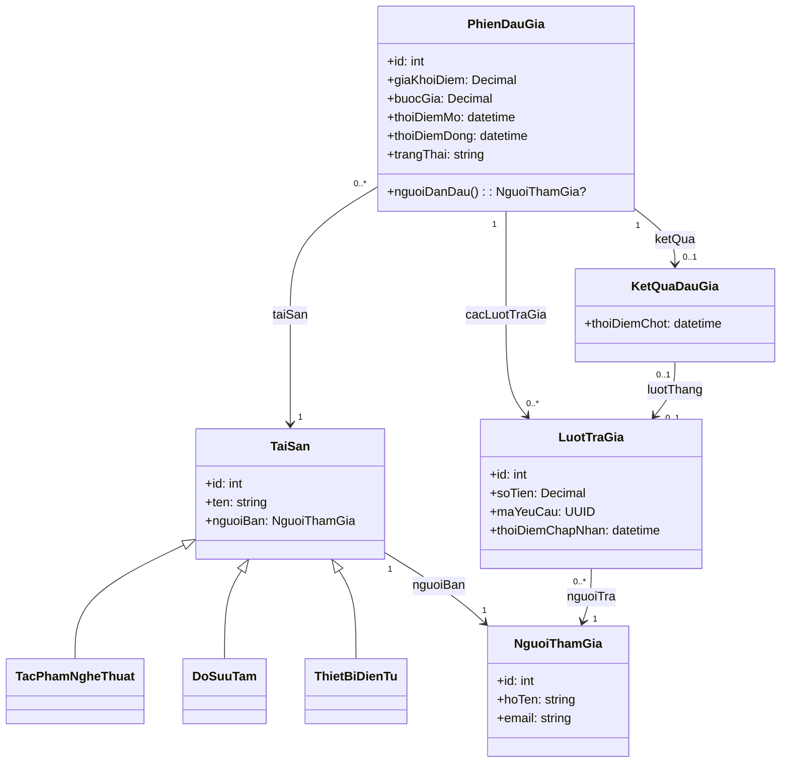

# Mô hình đối tượng, ODL và OQL

## 1. Phân biệt phạm vi thực thi

PostgreSQL của đồ án lưu dữ liệu quan hệ và chạy SQL/PLpgSQL. PostgreSQL **không có bộ thực thi ODMG OQL nguyên bản**. ODL/OQL dưới đây là đặc tả học thuật theo mô hình đối tượng; lệnh `python -m auction_lab oql` chạy các phép truy vấn Python tương đương trên đối tượng mẫu, không giả làm một OQL engine.

## 2. Mô hình lớp



`NguoiThamGia` là lớp người dùng có khả năng tham gia nghiệp vụ, không có nghĩa người này đã đăng ký mọi phiên. Quan hệ đăng ký được kiểm tra trong tầng nghiệp vụ/CSDL. Dùng `Decimal` cho tiền để tránh sai số nhị phân của `float`.

## 3. ODL rút gọn

Đây là ODL ở mức minh họa mô hình; khai báo kiểu tiền, thời gian và UUID có thể cần ánh xạ khác nhau tùy OODBMS.

```text
interface NguoiThamGia (extent NguoiDung key id) {
  attribute long id;
  attribute string hoTen;
  attribute string email;
};

interface TaiSan (extent TatCaTaiSan key id) {
  attribute long id;
  attribute string ten;
  relationship NguoiThamGia nguoiBan;
};
interface TacPhamNgheThuat : TaiSan (extent TacPham) { attribute string tacGia; };
interface DoSuuTam : TaiSan { attribute string boSuuTap; };
interface ThietBiDienTu : TaiSan { attribute string hangSanXuat; };

interface PhienDauGia (extent Phien key id) {
  attribute long id;
  attribute double giaKhoiDiem; // Ky hieu minh hoa; trien khai dung Decimal.
  attribute double buocGia;
  attribute string trangThai;
  relationship TaiSan taiSan;
  relationship list<LuotTraGia> cacLuotTraGia
    inverse LuotTraGia::phien;
  relationship KetQuaDauGia ketQua inverse KetQuaDauGia::phien;
};
interface LuotTraGia (extent Luot key id) {
  attribute long id;
  attribute double soTien;
  attribute string maYeuCau;
  relationship PhienDauGia phien inverse PhienDauGia::cacLuotTraGia;
  relationship NguoiThamGia nguoiTra;
};
interface KetQuaDauGia (extent KetQua) {
  relationship PhienDauGia phien inverse PhienDauGia::ketQua;
  relationship LuotTraGia luotThang;
};
```

`double` trong ODL chỉ là kiểu chuẩn dễ đọc của ví dụ ngôn ngữ; không dùng nó cho lưu trữ tiền của chương trình. Một OODBMS hỗ trợ kiểu tiền có thể thay bằng decimal domain.

## 4. Truy vấn OQL

### 4.1. Phiên đấu giá tác phẩm nghệ thuật

Phép ép kiểu và kiểm tra kiểu lớp có thể khác nhau giữa các triển khai ODMG. Biến thể dưới đây dùng extent riêng của lớp con để tránh phụ thuộc vào toán tử `instanceof` không đồng nhất:

```sql
SELECT p
FROM p IN Phien, a IN TacPham
WHERE p.taiSan = a AND p.trangThai = "OPEN";
```

Trong đó `TacPham` là extent chứa các đối tượng `TacPhamNgheThuat`, còn `Phien` chứa `PhienDauGia`.

### 4.2. Các lượt trả giá của phiên 1

```sql
SELECT STRUCT(id: b.id, nguoiTra: b.nguoiTra.hoTen, gia: b.soTien)
FROM p IN Phien, b IN p.cacLuotTraGia
WHERE p.id = 1
ORDER BY b.soTien DESC;
```

### 4.3. Người đang dẫn đầu của phiên 1

```sql
SELECT STRUCT(nguoiDan: b.nguoiTra.hoTen, giaDan: b.soTien)
FROM p IN Phien, b IN p.cacLuotTraGia
WHERE p.id = 1
  AND b.soTien = MAX(SELECT x.soTien FROM x IN p.cacLuotTraGia);
```

Phiên không có lượt trả giá cho kết quả rỗng. Quy tắc giá tăng nghiêm ngặt khiến không có hai lượt được chấp nhận cùng mức giá trong một phiên.

### 4.4. Người thắng đã chốt

```sql
SELECT STRUCT(phien: k.phien.id,
              nguoiThang: k.luotThang.nguoiTra.hoTen,
              giaThang: k.luotThang.soTien)
FROM k IN KetQua
WHERE k.luotThang != nil;
```

Người dẫn đầu là trạng thái tạm thời; người thắng chỉ xác lập sau khi đóng phiên thành công. Không đồng nhất hai khái niệm.

## 5. Đối chiếu SQL

```sql
SELECT a.id, s.title
FROM auction.auctions a
JOIN auction.assets s ON s.id = a.asset_id
WHERE s.kind = 'ARTWORK' AND a.status = 'OPEN';

SELECT b.id, u.full_name, b.amount, b.accepted_at
FROM auction.bids b
JOIN auction.users u ON u.id = b.bidder_id
WHERE b.auction_id = 1
ORDER BY b.amount DESC;

SELECT u.full_name, b.amount
FROM auction.auctions a
JOIN auction.bids b ON b.id = a.leading_bid_id
JOIN auction.users u ON u.id = b.bidder_id
WHERE a.id = 1;
```

SQL dùng khóa và phép join; mô hình đối tượng dùng định danh đối tượng và đi theo relationship. Chương trình mô phỏng giúp kiểm tra kết quả truy vấn mẫu, nhưng việc chống mất cập nhật vẫn do PostgreSQL transaction đảm nhiệm.
